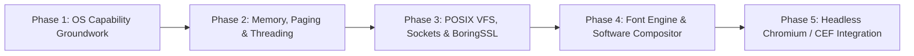

# FirstOS Chromium Port: Phase 1 OS Capability & Readiness Report

## 1. Executive Summary

This report establishes the verified Phase 1 readiness baseline for a future native Chromium port to the FirstOS operating system.

FirstOS is a 32-bit (x86/i686) operating system developed with a custom kernel, cooperative/preemptive multitasking, monolithic memory layout, native PCI drivers, a custom TCP/IP networking stack, a software-rendered window compositor, and an in-kernel HTML5 browser rendering pipeline.

### Core Phase 1 Scope & Boundary
Phase 1 intentionally performs **OS capability groundwork only**:
- **No Chromium source code is imported.**
- **No fake wrappers or stubs pretending unsupported subsystems exist.**
- **No premature attempts to compile Blink, V8, or Skia.**
- The objective of Phase 1 is to rigorously map FirstOS capabilities against Chromium's fundamental OS contract, identify blockers, build the platform abstraction interface, and deliver foundational high-leverage primitives.

---

## 2. Real Architecture Findings

| Subsystem | Real Files Inspected | Current Implementation Model |
| :--- | :--- | :--- |
| **Execution Model** | `boot.asm`, `kernel.c` | Monolithic Ring 0 kernel. Single-threaded cooperative/event loop with timer interrupts. |
| **Userspace Model** | `user.c`, `task.c`, `elf.c` | **No true Ring 3 userspace**. Tasks execute with kernel code selector (`CS=0x08`) and kernel data selector (`DS=0x10`). |
| **Process Model** | `task.c`, `posix/syscalls.c` | Up to 16 in-kernel tasks. `_fork()`, `_execve()`, `_wait()` return `-1`. No process hierarchy or PID namespaces. |
| **Threading Model** | `posix/pthreads_stub.c` | Broken stubs (`pthread_create` uses local stack page directory; `pthread_join` executes infinite `hlt`). |
| **Memory Model** | `paging.c`, `heap.c` | Flat identity-mapped 4MB pages covering 4GB. No per-process address spaces, no `mprotect` W^X enforcement, no demand paging. Static 1GB heap with first-fit allocator. |
| **Filesystem Model** | `fs.c`, `storage.c`, `vfs_fd.c` | Whole-file block table with hierarchical paths. Phase 1 introduces `vfs_fd.c` for standard `open/read/write/seek/stat/close` file descriptor operations. |
| **Graphics Model** | `framebuffer.c`, `compositor.c`, `virtio_gpu.c` | 32-bit linear software framebuffer (1024x768x32bpp) with dirty rect blitting. Virtio-GPU 2D resource flush to QEMU. No 3D GPU acceleration. |
| **Browser Model** | `web_browser_app.c`, `html5_engine.c` | In-kernel native browser running directly inside the desktop GUI event loop in Ring 0. |
| **Toolchain & Libc** | `Makefile`, `sysroot/i686-elf/` | Cross-compiler `i686-elf-gcc`, `nasm`, Newlib C library (`-lc -lm`). |

---

## 3. Chromium Prerequisite Matrix (28 Capabilities)

| # | Capability | Status | Code Evidence | Why It Matters for Chromium |
| :- | :--- | :--- | :--- | :--- |
| 1 | **Process Model** | **MISSING** | `posix/syscalls.c:26` | Multi-process sandbox (Browser, Renderer, GPU processes). |
| 2 | **Virtual Address Spaces** | **MISSING** | `paging.c:11-19` | Independent memory spaces for tabs and isolated origins. |
| 3 | **Memory Protection** | **MISSING** | `paging.c:13` | W^X protection for V8 JIT and page fault crash containment. |
| 4 | **Userspace Runtime** | **MISSING** | `task.c:115` | Ring 3 unprivileged application isolation. |
| 5 | **Libc Completeness** | **PARTIAL** | `-lc -lm` Newlib | Standard C library primitives required by Chromium base. |
| 6 | **C++ Runtime Support** | **PARTIAL** | `cxx_runtime.h` | Modern C++20 standard library, atomics, and constructors. |
| 7 | **Thread-Local Storage** | **PARTIAL** | `linux_syscalls.c:433` | Fast thread-local tasks and V8 thread isolates. |
| 8 | **Threading & Sync** | **MISSING** | `posix/pthreads_stub.c` | Multi-threaded task runners, worker pools, mutexes, condition variables. |
| 9 | **Timers & Monotonic Clocks** | **PRESENT** | `clock.c:38` (Phase 1) | Nanosecond/microsecond monotonic clock for event loops and vsync. |
| 10 | **File I/O** | **PRESENT** | `vfs_fd.c:45` (Phase 1) | Standard stream read, write, and seek operations. |
| 11 | **Directories & Paths** | **PARTIAL** | `fs.c:21` | Resource pack (.pak) loading, cache management. |
| 12 | **File Descriptors** | **PRESENT** | `vfs_fd.c:27` (Phase 1) | Uniform handles for files, pipes, and sockets. |
| 13 | **Pipes & Polling** | **MISSING** | No pipes or `epoll` | Inter-process Mojo IPC and event loop message pumping. |
| 14 | **Sockets** | **PARTIAL** | `net_socket.c`, `tcp.c` | Network service, WebSocket, HTTP/HTTPS fetch. |
| 15 | **DNS** | **PARTIAL** | `dns.c:30` | Domain resolution. |
| 16 | **TLS Support** | **PARTIAL** | `http_v11.c`, proxy bridge | HTTPS security, BoringSSL crypto primitives. |
| 17 | **Entropy / Randomness** | **PARTIAL** | `linux_syscalls.c:152` | CSPRNG for cryptographic nonces, UUIDs, V8 hash seeds. |
| 18 | **Shared Memory** | **MISSING** | No shm primitives | Zero-copy pixel buffer sharing between Renderer and Compositor. |
| 19 | **Dynamic Linking** | **PARTIAL** | `linux_elf.c` | Dynamic module loading or static-link fallback. |
| 20 | **Font Loading** | **MISSING** | `font.c` (8x16 bitmap only) | Scalable TrueType/OpenType font parsing (FreeType). |
| 21 | **Unicode & Text Shaping** | **PARTIAL** | `universal_layout/utf8.c` | HarfBuzz complex script shaping and ICU bidi. |
| 22 | **Graphics Surfaces** | **PRESENT** | `framebuffer.c`, `compositor.c` | 32-bit linear window surfaces. |
| 23 | **Window & Event Integration** | **PRESENT** | `gui.c` | Window management, keyboard/mouse input dispatch. |
| 24 | **Software Rendering** | **PRESENT** | `framebuffer.c` | Software canvas rasterization (Ozone headless). |
| 25 | **GPU Acceleration** | **MISSING** | `virtio_gpu.c` (2D only) | Hardware WebGL and GPU rasterization. |
| 26 | **Crash Handling & Logging** | **PARTIAL** | `serial.c`, `fault.c` | Serial logs and CPU fault traps. |
| 27 | **Sandbox Feasibility** | **MISSING** | Ring 0 monolithic kernel | Untrusted web content isolation. |
| 28 | **Multi-Process Feasibility** | **MISSING** | Single address space | Process per origin / tab. |

---

## 4. Phase 1 High-Impact Deliverables

To transition FirstOS from an ad-hoc monolithic kernel toward a structured OS platform capable of hosting complex runtimes, Phase 1 implemented four key foundational components:

### 1. Platform Abstraction Boundary (`include/firstos/platform/chromium_port_base.h`)
- Defined the clean C interface contract for:
  - Runtime capability probing (`firstos_platform_get_capabilities()`).
  - High-resolution monotonic timing.
  - Uniform file descriptors and metadata stat.
  - 32-bit graphics surfaces.
  - Process and thread telemetry.

### 2. High-Resolution Monotonic Clock Subsystem (`clock.h` / `clock.c`)
- Implemented `clock_monotonic_init()`, `clock_monotonic_get_ns()`, `clock_monotonic_get_us()`, and `clock_monotonic_get_ms()`.
- Automatically calibrates the x86 Time Stamp Counter (TSC) against the hardware PIT timer tick over startup.
- Enforces strict non-decreasing monotonicity, providing the microsecond-level timing resolution essential for Chromium task runners and message pumps.

### 3. Heap Telemetry & OOM Diagnostics (`heap.h` / `heap.c`)
- Upgraded the kernel heap allocator to track `peak_used_bytes`, `alloc_count`, `free_count`, and `oom_count`.
- Added `heap_get_stats()` and `heap_dump_diagnostics()` to provide telemetry on memory consumption during heavy workloads.

### 4. Uniform VFS File Descriptor Subsystem (`vfs_fd.h` / `vfs_fd.c`)
- Provided a thread-safe, 64-slot virtual file descriptor table wrapping FirstOS filesystem storage.
- Implemented standard semantics: `vfs_open()` with `O_CREAT/O_TRUNC/O_APPEND`, `vfs_read()`, `vfs_write()` with dynamic capacity expansion, `vfs_seek()` with `SEEK_SET/SEEK_CUR/SEEK_END`, `vfs_stat()`, `vfs_fstat()`, and `vfs_close()`.

---

## 5. Architectural Blockers for Future Phases

1. **Blocker 1: Ring 3 User/Kernel Separation & Paging Isolation**
   - *Severity*: CRITICAL
   - *Evidence*: `paging.c:13` maps all memory with supervisor RW flags; `task.c:115` launches tasks with `CS=0x08`.
   - *Chromium Requirement*: Crash isolation, V8 W^X security, virtual memory management (`mmap`, `munmap`, `mprotect`).
   - *Phase 1 Solvable*: No. Requires Phase 2 kernel paging overhaul.

2. **Blocker 2: Preemptive Multithreading & Synchronization**
   - *Severity*: CRITICAL
   - *Evidence*: `posix/pthreads_stub.c` lacks true pthread stack allocation, join synchronization, and condition variables.
   - *Chromium Requirement*: Chromium base relies on thread pools, task runners, and locks.
   - *Phase 1 Solvable*: No. Requires Phase 2 kernel threading support.

3. **Blocker 3: IPC & Pipes**
   - *Severity*: HIGH
   - *Evidence*: No anonymous pipes, domain sockets, or shared memory mechanisms exist in the kernel.
   - *Chromium Requirement*: Mojo IPC communication between Browser and Renderer processes.
   - *Phase 1 Solvable*: No. Target for Phase 2 / Phase 3.

---

## 6. Recommended Multi-Phase Roadmap

- **Phase 2 (Kernel & Runtime Core)**:
  - 4KB page directory/table management with demand paging and `mmap`/`munmap`/`mprotect`.
  - Ring 3 userspace transition: GDT user segments (`0x1B`, `0x23`), TSS ring 0 stack pointer, `sysenter`/`sysexit` or `int 0x80` trap return.
  - Preemptive kernel threads with pthread-compatible primitives (mutex, condvar, join).
- **Phase 3 (POSIX VFS, Networking & Crypto)**:
  - Complete POSIX VFS mapping for standard file descriptors, pipes, and sockets.
  - BoringSSL port / TLS 1.3 integration replacing proxy-bridge dependency.
- **Phase 4 (Graphics & Typography)**:
  - FreeType port for scalable TrueType/OpenType font rasterization.
  - HarfBuzz text shaping and ICU Unicode normalization.
  - Software-rendered Ozone backend feeding into the FirstOS desktop compositor.
- **Phase 5 (Chromium / CEF Native Build)**:
  - Compile Chromium base, V8, and headless Blink using the FirstOS platform abstraction layer.
