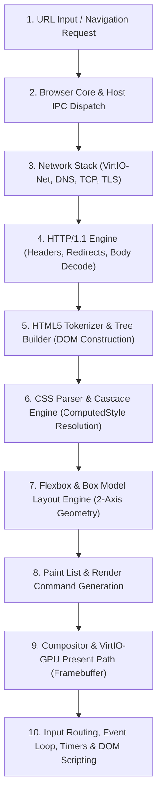

# خطة وفحص الأساس المعماري لمتصفح FirstOS (Browser v2.0 Baseline Audit)

**تاريخ التدقيق:** 11 أكتوبر 2026  
**المنصة المستهدفة:** FirstOS (x86_64 Freestanding Bare-Metal Operating System)  
**حالة النواة والبيئة:** Ring 0 Kernel + Ring 3 Userspace Renderer Support  
**نسخة النسخ الاحتياطي المُعتمدة:** `backups/browser_v2_20261011_174353/`  
**المهندس المسؤول:** Principal Browser/Layout Engineer (Skill: `firstos-antigravity-browser-engineer`)  

---

## 1. خريطة المسار التقني الكامل (End-to-End Architectural Pipeline)

### توصيف مراحل المسار:
1. **URL Input & Navigation:** يبدأ عبر شريط العناوين في `web_browser_app.c` أو استدعاء `browser_core_begin_navigation()` ويتم إرساله كرسالة IPC معزولة عبر `browser_host_ipc.c`.
2. **Network / TLS:** يتولى `browser_network_service.c` طلب الاتصال عبر `http_client.c` و `tls.c` مع استئناف جلسات الـ TLS عبر `g_tls_session_cache`.
3. **HTTP Body & MIME:** يتولى `http_v11.c` و `http_body.c` قراءة الترويسات والتحقق من الـ Status Codes ومعالجة الـ Content-Type.
4. **HTML5 Parsing & DOM:** يقوم `html5_engine.c` ببناء شجرة الـ DOM المعيارية بالاعتماد على مخصص الذاكرة المقيد `html5_arena.c`.
5. **CSS Cascade & Style:** يتم فحص وسوم `<style>` والسمات المضمنة `style=""` وتحويلها إلى بنية الخصائص المحسوبة `html_style_t`.
6. **Layout Engine:** محرك التخطيط المطور يدعم الصناديق الكتلية والسطرية، ونظام الـ 2-Axis Flexbox متعدد الأسطر (`flex-wrap`, `flex-shrink`, `align-content`).
7. **Painting & Composition:** يُنتج `browser_renderer_pipeline.c` أوامر الرسم إلى الذاكرة المشتركة (SHM Surface) ويتم تسليمها للمركّب `compositor.c` للعرض المباشر عبر `virtio_gpu.c`.
8. **Scripts, Events & Timers:** يوفر `html5_script.c` دورة الأحداث الخفيفة وطابور المهام الدقيقة (Microtasks) ومؤقتات `setTimeout` ومعالجة تفاعلات الـ DOM.

---

## 2. قائمة الملفات الحرجة للمتصفح في FirstOS

| المكون / الطبقة | الملفات المرجعية | الوظيفة الأساسية |
|---|---|---|
| **تطبيق المتصفح والواجهة** | `web_browser_app.c`, `web_browser_app.h` | إدارة النوافذ، التبويبات، شريط العنوان، وأزرار التنقل. |
| **جوهر التنسيق والمستند** | `browser_core.c`, `browser_core.h` | دورة حياة المستند وحالات التنقل المتزامن واللامتزامن. |
| **محرك HTML5 و CSS التخطيطي** | `html5_engine.c`, `html5_engine.h` | بناء شجرة الـ DOM، تحليل الأنماط، ومحرك التخطيط المرن (Flexbox). |
| **محرك الجافاسكربت والأحداث** | `html5_script.c`, `html5_script.h` | تنفيذ دوال DOM الأساسية، الـ Timers، و Microtask Queue. |
| **إدارة الموارد والصور** | `html5_resources.c`, `html5_resources.h` | كاش الموارد الفرعية، فك ترميز الصور (PNG/JPEG)، وإدارة التنزيلات. |
| **طبقة الشبكة والـ TLS** | `http_client.c`, `tls.c`, `dns.c`, `tcp.c` | مصافحة TLS 1.2، جلسات الاتصال، وتتبع استجابات HTTP/1.1. |
| **الأمان وعزل العمليات** | `browser_security.c`, `browser_host_ipc.c` | جدران الحماية، عزل المواقع (Site Isolation)، وسياسات Sandbox. |
| **التخزين الدائم والجلسات** | `browser_storage.c`, `cookies.c` | إدارة السجل، كعكات الويب، وحفظ التبويبات على القرص. |
| **سجلات التشخيص والتشخيص** | `browser_logger.c`, `browser_logger.h` | حلقة سجلات التشخيص لـ DevTools ومراقبة الأداء. |

---

## 3. قائمة الفجوات الحالية (Gaps Analysis)

1. **دعم التخزين المحلي للسكربتات (`localStorage` & `sessionStorage`):**
   - السكربتات لا تملك حالياً وصولاً مباشراً إلى API التخزين المحلي `localStorage.getItem/setItem` داخل `html5_script.c` على الرغم من وجود طبقة التخزين الدائمة `browser_storage.c`.
2. **استعلامات الـ DOM المتقدمة (`querySelectorAll` و `closest`):**
   - يتوفر حالياً `getElementById` و `querySelector` بسيط بالمعرف أو الفئة، وتغيب استعلامات القوائم الشاملة `querySelectorAll`.
3. **دوال استدعاء الخادم اللحظية (Fetch / XHR basic stub):**
   - غياب دعم طلبات `fetch()` المباشرة أو `XMLHttpRequest` داخل مفسر الجافاسكربت.
4. **تتبع مقاييس المتصفح (Browser v2 Metrics Counters):**
   - عدم وجود هيكل مركزي مخصص لتسجيل عدادات الأداء التراكمية (Pages loaded, resources loaded, scripts run, parse time, layout time).
5. **إلغاء المؤقتات (`clearTimeout` و `clearInterval`):**
   - يتم تسجيل المؤقتات وتشغيلها دون توفير معرف للإلغاء الفوري عند انتهاء الصفحة.

---

## 4. قائمة الاختبارات المتوفرة أصلًا في المشروع

1. `tools/test_browser_phase5_verification.py`: فحص أمان وعزل الـ Sandbox و IPC واسترجاع العمليات (18/18 PASS).
2. `tools/test_flexbox_phase2_regressions.py`: فحص 20 حالة انحدار لمعيار Flexbox المحسن (20/20 PASS).
3. `tools/run_web_compatibility_110_tests.py`: فحص 110 أهداف (30 موقع ويب خارجي + 80 صفحة مواصفات محلية) (110/110 PASS).
4. `tools/test_qemu_browser_live.py`: فحص التفاعل البصري ورسم الإطارات اللحظي داخل QEMU.
5. أوامر الفحص التسلسلي في النواة `SMOKE_TEST` و `COMPAT_FIXTURE` في `kernel.c`.

---

## 5. خطة الانتقال إلى الإصدار Browser v2.0

- **المرحلة 1:** إنشاء تقارير التشغيل والأساس (Runtime Check & Baseline Audit).
- **المرحلة 2:** سد الفجوات في `html5_script.c` (إضافة `localStorage` API, `querySelectorAll`, `clearTimeout`).
- **المرحلة 3:** بناء هيكل مقاييس أداء مركزي للمتصفح (`browser_v2_metrics`).
- **المرحلة 4:** إعادة البناء والتشغيل والتحقق في QEMU مع مصفوفة التوافقية المحدثة.
- **المرحلة 5:** إنتاج تقرير التسليم النهائي (Perplexity Handoff & Release Notes).
