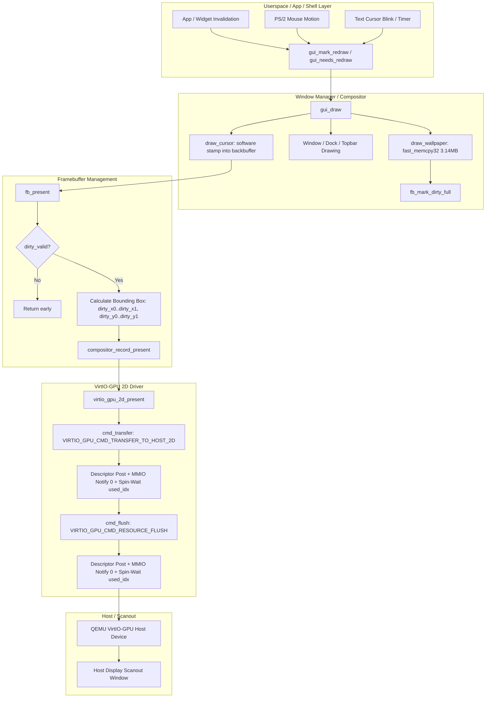
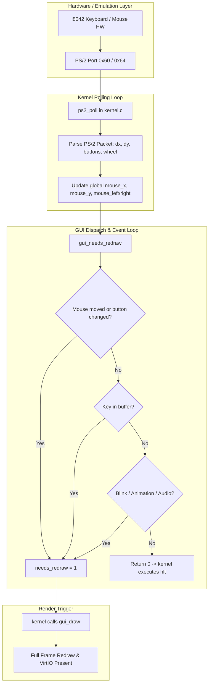

# FirstOS Graphics, UI & VirtIO-GPU Pipeline Audit (Phase 1)
**Date:** 2026-10-15  
**Author:** Principal Graphics & Systems Engineer  
**Scope:** `/Users/mohamadjlo/Desktop/FirstOS` (Kernel, Framebuffer, Compositor, VirtIO-GPU, GUI Shell, Input)

---

## 1. Executive Summary

A comprehensive file-by-file audit of the graphics rendering stack, window manager, input routing, and VirtIO-GPU backend was conducted across:
- `gui.c`, `gui.h`, `gui_internal.h`, `gui_widgets.c`, `gui_widgets.h`
- `framebuffer.c`, `framebuffer.h`
- `compositor.c`, `compositor.h`
- `virtio_gpu.c`, `virtio_gpu.h`, `virtio_gpu_2d.c`, `virtio_gpu_2d.h`, `virtio_gpu_protocol.h`
- `display_server.c`, `display_server.h`
- `desktop.c`, `desktop.h`, `dock.c`, `dock.h`, `theme.c`, `theme.h`
- `ps2.c`, `ps2.h`, `virtio_input.c`, `virtio_input.h`, `kernel.c`

The system currently runs natively on **VirtIO-GPU** (resolution 1024x768x32bpp) with full hardware acceleration protocol primitives (`VIRTIO_GPU_CMD_TRANSFER_TO_HOST_2D` and `VIRTIO_GPU_CMD_RESOURCE_FLUSH`). However, real-world smoothness and FPS are severely constrained by **several critical architectural bottlenecks**:
1. **Unconditional Full-Screen Repaints on Mouse Motion:** Every PS/2 mouse packet sets `needs_redraw = 1`. In `gui_draw()`, `draw_wallpaper()` copies the full 3.14 MB wallpaper into `fb.backbuffer` via `fast_memcpy32()` and invokes `fb_mark_dirty_full()`, forcing a complete 1024x768 VirtIO-GPU host transfer on every mouse nudge (~188 MB/s memory churn at 60 Hz).
2. **Synchronous Two-Stage VirtIO-GPU Command Submission:** Every `virtio_gpu_2d_present()` issues two separate synchronous commands sequentially (`cmd_transfer` then `cmd_flush`). Each command executes a descriptor write, an MMIO register notification (`*transport.ctrl_notify_ptr = 0`, causing an immediate QEMU VM-exit), and a busy-wait spinloop (`while (q->vring.used_idx == q->last_used_idx)`). This doubles VM-exit latency on every single presentation.
3. **Absence of Cursor Save-Under / Restore-Under Buffer:** The software cursor (`draw_cursor()`) is stamped directly into `fb.backbuffer`. Because previous background pixels under the cursor are not saved, the window manager cannot simply erase the cursor without repainting the entire desktop background and all windows underneath.
4. **Coarse Bounding Box Damage Tracking:** `framebuffer.c` compresses all dirty regions into a single enclosing rectangle `[dirty_x0, dirty_y0, dirty_x1, dirty_y1]`. If the top menu bar (y=10) and the bottom dock (y=740) both invalidate, the entire screen is transferred across the PCIe/MMIO boundary.
5. **Redraw Loop Jitter:** `kernel.c` runs an unthrottled loop where text cursor blinking (every 18 ticks) and FPS counter string formatting trigger unnecessary full-screen invalidations even when the system is visually idle.

---

## 2. End-to-End Presentation Pipeline Map



---

## 3. End-to-End Input Pipeline Map



---

## 4. Ranked List of Bottlenecks (By Real Impact)

| Rank | Bottleneck | Component | Performance Impact | Proposed Resolution |
|---|---|---|---|---|
| **1** | **Wallpaper Copy + Full Dirty Invalidation on Mouse Motion** | `gui.c` (`draw_wallpaper`) | Copies 3,145,728 bytes of memory and transfers 3.14 MB over VirtIO-GPU on every mouse packet (~60-125 Hz). Dominates CPU & bus utilization. | Implement cursor save-under buffer or isolate cursor redraw to its bounding box (~32x32 = 4KB), bypassing wallpaper blit when only cursor moves. |
| **2** | **Sequential 2-Command Submission (Transfer then Flush)** | `virtio_gpu_2d.c` & `virtio_gpu.c` | 2 separate MMIO VM-exits and 2 synchronous CPU spin-waits on every presentation. | Batch `TRANSFER_TO_HOST_2D` and `RESOURCE_FLUSH` descriptors into a single virtqueue notify & wait cycle. |
| **3** | **Coarse Single Bounding Box Damage Tracking** | `framebuffer.c` (`fb_mark_dirty_rect`) | Disjoint updates (e.g. clock at top bar + dock hover at bottom) expand to full screen damage (1024x768). | Maintain list of distinct dirty rectangles in `compositor.c` or multi-rect present to transmit only actual damaged rectangles. |
| **4** | **Unprotected Hot-Path Spin-Waiting** | `virtio_gpu.c` (`virtio_gpu_submit_common`) | Busy-spins with `pause` up to `SUBMIT_TIMEOUT` (0x7FFFFFFF), consuming 100% core cycles during host processing. | Add batching and optimize timeout/pause semantics; verify descriptors cleanly. |
| **5** | **Frequent Timer-Induced Redraws** | `gui.c` (text cursor blink, FPS counter) | Text cursor blinking (every 18 ticks) invalidates full screen when desktop is otherwise idle. | Limit cursor blink redraw to the active text field rectangle only. Decouple FPS counter redraw from full screen refresh. |
| **6** | **Redundant Wallpaper Memory Blits under Maximized Windows** | `gui.c` (`gui_draw`) | Wallpaper is unconditionally blitted even when an opaque maximized window covers the entire workspace (1024x732). | Detect fully opaque fullscreen/maximized active window and skip wallpaper memcpy completely. |
| **7** | **Monolithic GUI Orchestration in `gui.c`** | `gui.c` (12,522 lines) | Window manager, widget rendering, damage collection, and presentation policy are tightly intertwined. | Modularize damage collection and presentation policy cleanly into `compositor` and `display_server`. |

---

## 5. Architectural Findings & Code References

1. **`gui.c:3476` (`draw_wallpaper`)**:
   ```c
   if (fb.pitch == w * 4) {
       fast_memcpy32(fb.backbuffer, wallpaper_cache, w * h);
   }
   fb_mark_dirty_full();
   ```
   *Analysis:* This is executed unconditionally on almost every `gui_draw()` invocation. Because `fb_mark_dirty_full()` sets `dirty_x0 = 0, dirty_y0 = 0, dirty_x1 = fb.width, dirty_y1 = fb.height`, fine-grained dirty tracking in individual widgets is completely nullified.

2. **`virtio_gpu_2d.c:193` (`virtio_gpu_2d_present`)**:
   ```c
   int virtio_gpu_2d_present(virtio_gpu_2d_t *g, u32 x, u32 y, u32 w, u32 h) {
       if (!g || !g->ready) return -1;
       if (cmd_transfer(g, x, y, w, h) < 0) return -2;
       if (cmd_flush(g, x, y, w, h) < 0) return -3;
       return 0;
   }
   ```
   *Analysis:* `cmd_transfer` calls `virtio_gpu_submit2`, which maps descriptors 0 and 1, notifies queue via MMIO, and spinloops. Immediately upon return, `cmd_flush` maps descriptors 0 and 1, notifies queue via MMIO, and spinloops again. Since VirtIO control virtqueue size is 8 (`VIRTQ_NUM = 8`), both commands can be queued together and executed in a single notify.

3. **`framebuffer.c:68` (`fb_mark_dirty_rect`)**:
   ```c
   if (!dirty_valid) {
       dirty_x0 = (u32)x0; dirty_y0 = (u32)y0; dirty_x1 = (u32)x1; dirty_y1 = (u32)y1;
       dirty_valid = 1;
   } else {
       if ((u32)x0 < dirty_x0) dirty_x0 = (u32)x0;
       if ((u32)y0 < dirty_y0) dirty_y0 = (u32)y0;
       if ((u32)x1 > dirty_x1) dirty_x1 = (u32)x1;
       if ((u32)y1 > dirty_y1) dirty_y1 = (u32)y1;
   }
   ```
   *Analysis:* Single bounding box model causes catastrophic damage amplification for non-contiguous UI elements.

4. **`kernel.c:436` (`kernel_main` event loop)**:
   ```c
   if (gui_needs_redraw()) {
       gui_is_idle = 0;
       gui_draw();
   } else {
       gui_is_idle = 1;
       __asm__ volatile("hlt" ::: "memory");
   }
   ```
   *Analysis:* Sound architecture, but `gui_needs_redraw()` is constantly kept non-zero by mouse jitter and timer ticks.
