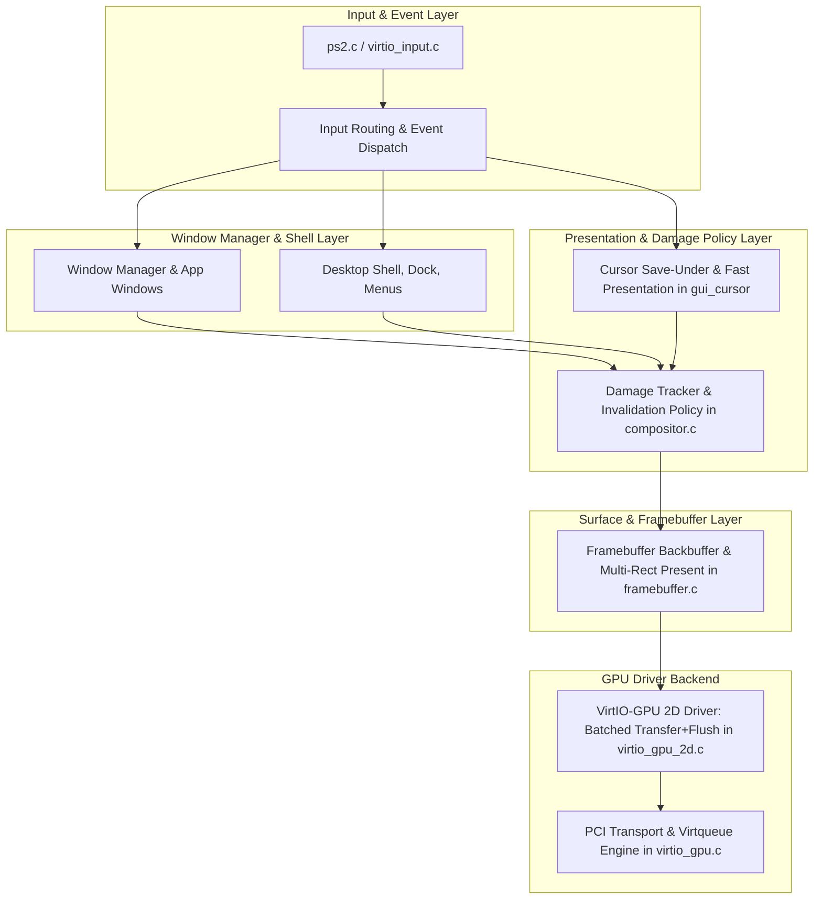

# FirstOS Graphics Architecture Split Plan (Phase 3)
**Date:** 2026-10-15  
**Author:** Principal Graphics & Systems Engineer  
**Scope:** Modularization of `gui.c`, Compositor Damage Management, and Presentation Policy

---

## 1. Architectural Motivation

Currently, `gui.c` comprises over 12,500 lines of code and conflates multiple distinct system domains:
1. **Window Manager & Application Lifecycles:** Window stacking, active focus, minimize/maximize state, window titles.
2. **Desktop Shell & Widgets:** Top bar, dock, start menu, spotlight, file dialogs, system clock.
3. **Cursor State & Rendering:** Reading PS/2 coordinates, picking cursor glyph styles, stamping pixels into `fb.backbuffer`.
4. **Damage & Invalidation Policy:** Setting `needs_redraw = 1`, deciding whether to blit the full 3.14 MB wallpaper, calling `fb_mark_dirty_full()`.
5. **GPU Presentation Orchestration:** Directly invoking `fb_present()`.

This lack of separation causes cross-domain contamination: for instance, a 1-pixel mouse move in domain (3) triggers a full wallpaper memory blit in domain (4) and an unclipped full-screen scanout in domain (5).

---

## 2. Target Component Boundaries

---

## 3. Phased Split Plan

### Step 3.1: Cursor Isolation & Fast Presentation Path
- Move cursor save-under/restore-under management into a distinct, dedicated subsystem.
- Decouple mouse move events that do not interact with window borders, titlebars, or controls from the main `gui_draw()` window compositor loop.
- Mouse movement will trigger `gui_cursor_present_fast()`:
  - Restore previous background (32x32 pixels = 4 KB).
  - Save new background (32x32 pixels = 4 KB).
  - Draw cursor glyph.
  - Present only the two small damaged rectangles directly to VirtIO-GPU.

### Step 3.2: Multi-Rect Damage Collection in Compositor
- Migrate damage bounds management so callers (windows, dock, menus) register damage rects into `compositor_damage(x, y, w, h)`.
- `framebuffer.c` queries discrete damage regions or coalesced bounding boxes when presenting, rather than relying on a single global bounding box.

### Step 3.3: Wallpaper Occlusion Caching
- When the active window is maximized or fills the entire workspace, `draw_wallpaper()` is bypassed completely, saving 3,145,728 bytes of memory copy per redraw cycle.
