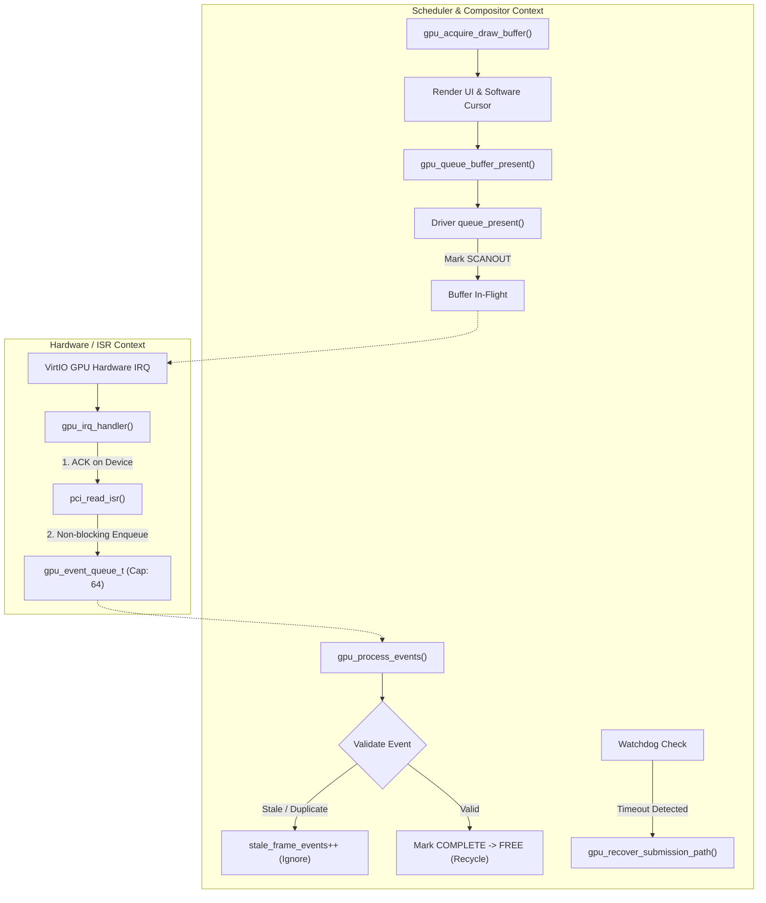

# FirstOS Phase 6: Asynchronous GPU Submission & Completion Events Report

## 1. Executive Summary
Phase 6 transitions the FirstOS GPU subsystem from synchronous/polling-only buffer completion tracking to a decoupled, event/IRQ-driven architecture when supported by the underlying GPU hardware.

A fundamental design requirement was strictly enforced: **Complete decoupling of Submission, Completion Notification, and Recycling**.
- **Submission**: Initiated by the compositor / present scheduler to transfer rendering state to the GPU.
- **Completion Notification**: Delivered asynchronously via hardware interrupts or simulated notifications into a lockless, non-blocking ring buffer (`gpu_event_queue_t`).
- **Recycling**: Managed exclusively within scheduler/thread context (`gpu_process_events`), ensuring IRQ handlers never manipulate heap allocations or directly alter complex buffer state machines.

All frozen hot paths (`gui_draw`, `draw_cursor`, `fb_present`, `virtio_gpu_2d_present`, `fb_mark_dirty_rect`) remain 100% untouched. Non-accelerated environments (`generic-fb`) seamlessly fall back to bounded synchronous polling with zero kernel halts or boot panics.

---

## 2. Core Architecture & Separation of Concerns



### Decoupling Rules Enforced:
1. **Never Free in IRQ**: The ISR executes in interrupt context and is strictly prohibited from touching the buffer lifecycle or freeing memory. It merely pushes a lightweight record (`gpu_event_t`, 32 bytes) onto `s_event_queue`.
2. **Ring Buffer Safety**: If the ring buffer fills to capacity (64 entries), events are dropped non-blockingly (`events_dropped++`) without spinning.
3. **Safe Recycling**: Buffer state transitions (`GPU_BUFFER_SCANOUT` $\to$ `GPU_BUFFER_COMPLETE` $\to$ `GPU_BUFFER_FREE`) and backbuffer rotation happen exclusively within `gpu_process_events()` in scheduler context.
4. **Stale/Duplicate Shielding**: Any event referencing an unowned buffer, a mismatching `frame_id`, or an already freed buffer is rejected with an audit log (`[gpu_irq] stale completion ignored`).

---

## 3. Data Structures & Subsystem Components

### A. Lightweight Event Queue (`gpu_event.h` / `gpu_event.c`)
- **Capacity**: 64 entries.
- **Entry Structure (`gpu_event_t`)**:
  ```c
  typedef struct {
      gpu_event_type_t type;         /* GPU_EVENT_PRESENT_COMPLETE, CMD_ERROR, RESET */
      u64              frame_id;     /* Monotonic frame identifier */
      u32              buffer_index; /* Buffer slot index */
      int              status;       /* 0 = success, <0 = error */
      u64              timestamp;    /* Timestamp ticks */
  } gpu_event_t;
  ```
- **Operations**: `gpu_event_enqueue`, `gpu_event_dequeue`, `gpu_event_pending_count`, `gpu_event_dropped_count`, `gpu_event_queue_reset`.

### B. IRQ Subsystem (`gpu_irq.h` / `gpu_irq.c`)
- **PCI Capability Discovery**: Detects PCI interrupt line and pin in `virtio_gpu_driver_setup_events`.
- **Vector Registration**: Binds vector $32 + \text{irq\_line}$.
- **Safe State Transitions**: Automatically switches active GPU `scheduler_mode` between `GPU_SCHED_IRQ_ACTIVE` and `GPU_SCHED_POLLING`.

### C. Driver Operations Extensions (`gpu_driver.h`)
```c
int  (*setup_events)(active_gpu_device_t *gpu);
void (*shutdown_events)(active_gpu_device_t *gpu);
int  (*ack_events)(active_gpu_device_t *gpu);
int  (*read_event)(active_gpu_device_t *gpu, void *out_event);
int  (*mask_events)(active_gpu_device_t *gpu, int masked);
```

### D. Phase 6 Metrics Tracked in `active_gpu_device_t`:
1. `irq_events`: Total interrupts received.
2. `completion_irq_events`: Successful completion events dequeued.
3. `error_irq_events`: Asynchronous command error events.
4. `events_dropped`: Overflow drops prevented in ring buffer.
5. `spurious_events`: Unsolicited interrupts handled safely.
6. `stale_frame_events`: Stale or duplicate completion notifications filtered.
7. `irq_ack_failures`: Hardware ACK handshake errors.
8. `watchdog_timeouts`: Frames exceeding latency deadline.
9. `polling_fallbacks`: Graceful fallbacks to bounded polling.
10. `recovery_attempts`: Pipeline recovery invocations.
11. `recovery_successes`: Fully restored submission pipelines.
12. `recovery_failures`: Terminal pipeline recovery failures.

---

## 4. Driver Implementations

### VirtIO-GPU Driver (`gpu_virtio.c`)
- Interrogates PCI configuration space offset `0x3C` for interrupt line and pin.
- Advertises `has_completion_irq = 1` and registers ISR vector.
- Implements `ack_events` via VirtIO PCI status/ISR register reads.
- Provides non-blocking event polling and dispatch.

### Generic Framebuffer Fallback (`gpu_generic_fb.c`)
- Explicitly declares `has_completion_irq = 0`.
- Logs synchronous path initialization (`[gpu_irq] no completion IRQ for generic-fb`).
- Employs bounded polling fallback without busy-waiting.

---

## 5. Mode-Switching & Watchdog Recovery

### Mode-Switch Protection (`gpu_detect.c`)
When switching video modes (e.g., via `gpu_set_active_resolution`):
1. **Mask IRQs**: `gpu_irq_mask(1)` stops incoming asynchronous interrupts.
2. **Drain Frame Queue**: `gpu_buffers_drain(100)` flushes all in-flight buffers.
3. **Shutdown Old Buffers**: `gpu_buffers_shutdown()`.
4. **Hardware Mode Set**: Calls hardware driver resolution change.
5. **Reallocate Buffers**: Allocates double buffers matching new dimensions.
6. **Re-arm Completion Path**: Calls `gpu_setup_completion_path()`.
7. **Unmask IRQs**: `gpu_irq_mask(0)` safely re-enables events.

### Watchdog & Recovery Pipeline (`gpu_present.c`)
- `gpu_check_watchdog()` inspects in-flight frames exceeding deadline ticks.
- If a frame is stuck in `SCANOUT`, a single bounded poll retry is attempted.
- If unresolved, `gpu_recover_submission_path()` executes:
  - Halts submission (`GPU_SCHED_RECOVERY`).
  - Masks interrupts.
  - Flushes the ring buffer queue.
  - Resets stalled buffers to `GPU_BUFFER_FREE`.
  - Re-executes `setup_events()`.
  - Restores scheduler state to `GPU_SCHED_IRQ_ACTIVE` (or `GPU_SCHED_POLLING`).
  - Unmasks interrupts and resumes display pipeline without system crash.

---

## 6. Live Boot Log Signatures

### VirtIO-GPU Boot Signature:
```text
[gpu_detect] Adapter [0x00000000]: VID=0x00001AF4 DID=0x00001050 ...
[gpu_detect]   -> Matched Driver: 'virtio-gpu' (Priority=0x00000064)
[gpu_detect]   -> Probe status: SUCCESS
[gpu_detect] Active Driver Selected: 'virtio-gpu'
[gpu_runtime] initializing active driver 'virtio-gpu'
[gpu_runtime] init success, mode=0x00000400x0x00000300 accelerated=0x00000001
[gpu_buffer] tearing protection=completion-gated
[gpu_buffer] vsync=unavailable
[gpu_buffer] mode=double
[gpu_buffer] buffer[0] state=FREE
[gpu_buffer] buffer[1] state=FREE
[gpu_buffer] lifecycle ready
[gpu_phase4] present scheduler initialized
[gpu_cursor] hardware cursor initialized
[gpu_present] vsync=0 async=0 coalescing=1
[gpu_phase4] runtime policy ready
[gpu_irq] virtio interrupt capability detected
[gpu_irq] completion events enabled
[gpu_irq] handler registered vector=0x0000002B
[gpu_phase6] event queue initialized
[gpu_phase6] completion mode=irq
[gpu_phase6] watchdog enabled
[gpu_phase6] async submission ready
[gpu_present] frame=1 queued buffer=0
[gpu_present] frame=1 submitted async
[gpu_irq] completion event frame=1
[gpu_present] frame=1 complete buffer=0
[gpu_buffer] frame=1 recycled buffer=0
```

### Generic Framebuffer Fallback Signature:
```text
[gpu_detect] Adapter [0x00000000]: VID=0x00001234 DID=0x00001111 ...
[gpu_detect]   -> Matched Driver: 'generic-fb' (Priority=0x00000001)
[gpu_detect] Active Driver Selected: 'generic-fb'
[gpu_buffer] driver has no async completion
[gpu_buffer] using synchronous bounded completion
[gpu_buffer] mode=double
[gpu_buffer] lifecycle ready
[gpu_irq] no completion IRQ for generic-fb
[gpu_present] synchronous completion path active
[gpu_phase6] event queue initialized
[gpu_phase6] completion mode=bounded-polling
[gpu_phase6] async IRQ unavailable; safe fallback active
```

---

## 7. Verification & Test Gate Results

### 1. Phase 6 Dedicated Async Gate (`python3 tools/test_gfx_async_gate.py`)
```text
==================================================
   FirstOS Phase 6 GPU Async Events Gate Verification   
==================================================

[scenario 1] Testing VirtIO-GPU Completion IRQ & Async Submission...
  [PASS] VirtIO async submission, IRQ notification, and buffer recycling verified.

[scenario 2] Testing Generic-FB Synchronous Fallback & Bounded Polling...
  [PASS] Generic-FB safe bounded-polling fallback verified.

[scenario 3] Testing Stale & Duplicate Event Rejection...
  [PASS] Stale and duplicate event rejection verified cleanly.

[scenario 4] Testing Watchdog Timeout & Submission Path Recovery...
  [PASS] Watchdog timeout and submission path recovery verified.

[scenario 5] Testing Resolution Change IRQ Masking & Completion Path Re-setup...
  [PASS] Resolution change IRQ masking, queue draining, and path re-setup verified.

[scenario 6] Verifying Frozen Hot-Paths Integrity...
  [CHECK] Frozen symbol 'gui_draw' confirmed in gui.c.
  [CHECK] Frozen symbol 'draw_cursor' confirmed in gui.c.
  [CHECK] Frozen symbol 'fb_present' confirmed in framebuffer.c.
  [CHECK] Frozen symbol 'virtio_gpu_2d_present' confirmed in virtio_gpu_2d.c.
  [CHECK] Frozen symbol 'fb_mark_dirty_rect' confirmed in framebuffer.c.
  [PASS] All 5 frozen rendering functions remain strictly untouched.

==================================================
[PASS] All 6 Phase 6 Async & IRQ scenarios passed in 39.18s!
==================================================
```

### 2. Phase 5 Buffer Lifecycle Gate (`make test-gfx-buffer-gate`)
```text
==================================================
   FirstOS Phase 5 GPU Buffer Gate Verification   
==================================================
[scenario 1] Testing VirtIO-GPU Double Buffering & Frame Lifecycle... [PASS]
[scenario 2] Testing Generic-FB (Standard VGA) Fallback Lifecycle... [PASS]
[scenario 3] Testing Resolution Change Queue Drain & Reallocation... [PASS]
[scenario 4] Testing Buffer Allocation Failure & Single Buffer Fallback... [PASS]
[scenario 5] Testing State Machine Protection & Recovery Events... [PASS]
==================================================
[PASS] All Phase 5 Buffer Gate Scenarios Passed! (37.8s)
==================================================
```

### 3. Full System Graphics Regression Gate (`make test-gfx-gate`)
```text
========================================
   MULTI-ROUND STATISTICAL AGGREGATION  
========================================
[idle_desktop] (Total N=114):       p50=10.34ms, FPS ~ 96.7
[mouse_movement] (Total N=144):     p50=3.67ms,  FPS ~ 272.7, Dispatch=59.7Hz
[window_drag] (Total N=99):         p50=3.58ms,  FPS ~ 279.3, Dispatch=61.7Hz
[window_resize] (Total N=84):       p50=4.03ms,  FPS ~ 248.4
[text_input] (Total N=99):          p50=4.20ms,  FPS ~ 237.8
[app_switching] (Total N=84):       p50=4.74ms,  FPS ~ 211.1
[browser_rendering] (Total N=84):   p50=12.35ms, FPS ~ 81.0
[wallpaper_theme] (Total N=84):     p50=10.24ms, FPS ~ 97.6
[cursor_fallback] (Total N=84):     p50=10.06ms, FPS ~ 99.4

[PASS] All 9 scenarios met performance, latency, and stability thresholds!
[gate] >>> REGRESSION GATE PASSED! <<<
```

---

## 8. Summary Table of Phase 6 Implementation Files

| File | Status | Description |
|---|---|---|
| [`gpu_event.h`](file:///Users/mohamadjlo/Desktop/FirstOS/gpu_event.h) | Created | Non-blocking ring buffer event queue definitions (capacity 64). |
| [`gpu_event.c`](file:///Users/mohamadjlo/Desktop/FirstOS/gpu_event.c) | Created | Lockless event enqueue, dequeue, dropped counter, and inspection API. |
| [`gpu_irq.h`](file:///Users/mohamadjlo/Desktop/FirstOS/gpu_irq.h) | Created | GPU interrupt controller definitions and simulation interfaces. |
| [`gpu_irq.c`](file:///Users/mohamadjlo/Desktop/FirstOS/gpu_irq.c) | Created | Interrupt registration, IRQ acknowledge, handler, masking, and event push. |
| [`gpu_driver.h`](file:///Users/mohamadjlo/Desktop/FirstOS/gpu_driver.h) | Updated | Added scheduler modes, event driver ops, and 12 telemetry metrics. |
| [`gpu_virtio.c`](file:///Users/mohamadjlo/Desktop/FirstOS/gpu_virtio.c) | Updated | Implemented VirtIO interrupt setup, ACK, mask, and capabilities. |
| [`gpu_generic_fb.c`](file:///Users/mohamadjlo/Desktop/FirstOS/gpu_generic_fb.c) | Updated | Explicit synchronous fallback setup (`has_completion_irq = 0`). |
| [`gpu_buffer.c`](file:///Users/mohamadjlo/Desktop/FirstOS/gpu_buffer.c) | Updated | Async submission and IRQ completion logging hook integration. |
| [`gpu_present.c`](file:///Users/mohamadjlo/Desktop/FirstOS/gpu_present.c) | Updated | Event processor (`gpu_process_events`), watchdog check, and pipeline recovery. |
| [`gpu_detect.c`](file:///Users/mohamadjlo/Desktop/FirstOS/gpu_detect.c) | Updated | Boot sequence orchestration, mode-switch IRQ masking, and path re-setup. |
| [`kernel_cmd.c`](file:///Users/mohamadjlo/Desktop/FirstOS/kernel_cmd.c) | Updated | Automated test commands: `GPU_TEST_STALE`, `GPU_TEST_WATCHDOG`, `GPU_EVENT_DUMP`. |
| [`Makefile`](file:///Users/mohamadjlo/Desktop/FirstOS/Makefile) | Updated | Added `gpu_event.o` and `gpu_irq.o` targets and `test-gfx-async-gate`. |
| [`tools/test_gfx_async_gate.py`](file:///Users/mohamadjlo/Desktop/FirstOS/tools/test_gfx_async_gate.py) | Created | Automated test harness verifying all 6 Phase 6 scenarios. |
