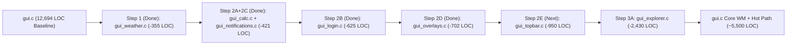

# FirstOS `gui.c` Incremental Decomposition Plan (`gui_split_plan.md`)

**Date:** 2026-10-16  
**Target File:** `gui.c` (`12,694` LOC before extraction → `12,339` LOC after Step 1 extraction)  
**Constraint:** Do not touch the frozen hot path (`gui_draw`, `draw_cursor`, `fb_present`, `virtio_gpu_2d_present`, `fb_mark_dirty_rect`).

---

## 1. Current Subsystem Map of `gui.c`

| Subsystem | Original Line Range (`gui.c`) | Approx LOC | Hot-Path Coupling | Extraction Priority |
|---|---|---|---|---|
| **1. Weather Service & Weather Art** | `261–268`, `5373–5749` | `~385` | **None** (`weather_tick` called 1Hz; `draw_weather_icon` called by top bar/widget) | **Completed (Step 1)** → `gui_weather.c` / `gui_weather.h` |
| **2. Calculator App** | `5884–5950`, `10523–10559` | `~120` | **None** (`draw_calculator_contents`, `calc_handle_click`) | **Completed (Step 2A)** → `gui_calc.c` / `gui_calc.h` |
| **3. Notification Center Subsystem** | `281–298`, `5675–5798`, `10324–10370` | `~200` | **None** (`draw_notification_center`, `notification_center_handle_click`) | **Completed (Step 2C)** → `gui_notifications.c` / `gui_notifications.h` |
| **4. Login & Lock Screen Manager** | `668–717`, `823–1465` | `~700` | **Low** (`login_draw`, `login_handle_key`, `login_handle_click`) | **Completed (Step 2B)** → `gui_login.c` / `gui_login.h` |
| **5. Launchpad, Spotlight & Quick Look Overlays** | `11050–11765` | `~715` | **Low** (`draw_launcher_overlay`, `draw_spotlight_overlay`, `draw_explorer_quick_look`) | **Completed (Step 2D)** → `gui_overlays.c` / `gui_overlays.h` |
| **6. Top Bar Popovers & Clock** | `4908–5364`, `5374–5580` | `~950` | **Low** (`draw_top_bar`, `draw_volume_menu`, `draw_clock_menu`, `draw_fps_dropdown`) | **Phase 2E (Next)** → `gui_topbar.c` / `gui_topbar.h` |
| **7. File Explorer UI, Thumbnails & File Ops** | `6060–6630`, `7030–8890` | `~2,430` | **Medium** (`draw_explorer_contents`, `handle_explorer_click`, `sync_desktop_icons_from_fs`) | **Phase 3A** → `gui_explorer.c` / `gui_explorer.h` |
| **8. Window Manager & Input/Drag Router** | `1467–3274`, `6631–7029`, `8891–11049` | `~4,350` | **High** (shares window z-order, snap state, and dirty-rect flags with `gui_draw`) | **Keep in `gui.c` Core** |
| **9. Frozen Render & Cursor Hot Path** | `4304–4502`, `11973–12339` | `~565` | **Frozen** (`gui_cursor_save`, `gui_cursor_restore`, `draw_cursor`, `gui_draw`) | **Keep in `gui.c` Core (Frozen)** |

---

## 2. Steps Executed in This Phase

### Step 1: `gui_weather.c` / `gui_weather.h`
- Extracted weather telemetry, polling, and procedural vector icon rendering.
- Net reduction: **-355 LOC**.

### Step 2A: `gui_calc.c` / `gui_calc.h`
- Extracted Calculator state, display formatting, button grid rendering, and click event handler.
- Fixed decimal base-10 formatting bug (`v % 16` -> `v % 10`).

### Step 2C: `gui_notifications.c` / `gui_notifications.h` & Dead Code Removal
- Extracted Notification Center state, default alerts, bell rendering, card layout, and interactive dismissal handler.
- Removed dead legacy media player and image preview rendering functions left over from prior extractions.
- Updated `Makefile` with order-only prerequisites (`| check-iso-tools`) to eliminate redundant 108MB ISO writing during testing.
- Net reduction in Patch 3: **-421 LOC** (`12,339` -> `11,918` LOC; **-776 LOC total**).
- Verified with `make test-gfx-gate`: **PASS (0 regressions)**.

### Step 2B: `gui_login.c` / `gui_login.h` (Patch 4)
- Extracted lock screen and login dialog, authentication credentials, keyboard input handling, mouse click event processing, and avatar caching/rendering.
- Added clean decoupled hooks `gui_desktop_on_logout()` and `gui_trigger_post_boot_fs()` in `gui.c`.
- Net reduction in Patch 4: **-625 LOC** (`11,918` -> `11,293` LOC; **-1,401 LOC total**).
- Verified with `make test-gfx-gate`: **PASS (0 regressions)**.

### Step 2D: `gui_overlays.c` / `gui_overlays.h` (Patch 5)
- Extracted Launchpad app grid (`draw_launcher_overlay`), Spotlight search modal (`draw_spotlight_overlay`), and Explorer Quick Look file viewer (`draw_explorer_quick_look`).
- Consolidated duplicate `draw_icon_scaled()` between `desktop.c` and `gui.c` into a clean shared function.
- Net reduction in Patch 5: **-702 LOC** (`11,293` -> `10,591` LOC; **-2,103 LOC total** from baseline `12,694`).
- Verified with `make test-gfx-gate`: **PASS (0 regressions)** across all 9 scenarios.

---

## 3. Step-by-Step Roadmap for Next Decomposition Phases

### Rules for Each Future Extraction Step
1. Extract **one module per commit/patch**.
2. Expose only minimal state in `gui_internal.h` or a dedicated `gui_<module>.h` header.
3. Never modify `gui_draw` or `draw_cursor` signatures or control flow.
4. Run `make -j4 kernel.bin && make firstos.iso && make test-gfx-gate` after each module extraction.
