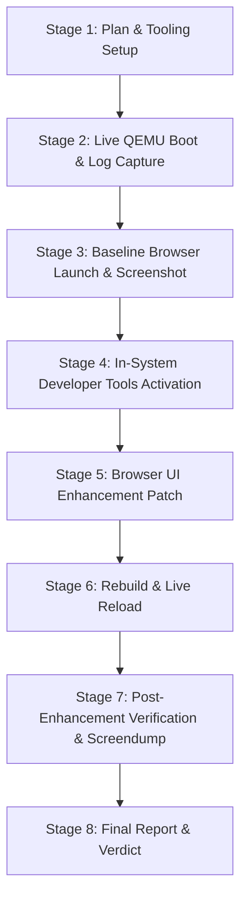

# FirstOS Live In-System Browser Development Session Plan

**Session**: Live In-System Browser Development Session  
**Engineer Skill**: `firstos-antigravity-browser-engineer`  
**Date**: 2026-10-15  
**Workspace**: `/Users/mohamadjlo/Desktop/FirstOS`  

---

## 1. Executive Summary & Objective

The objective of this session is to conduct an interactive, observable live development cycle on the FirstOS native web browser while the operating system is actively executing inside QEMU. Rather than purely offline code edits, the session demonstrates:
1. Live execution of FirstOS with GUI compositor, Window Manager, and in-system developer tools (App Studio and Terminal).
2. Live interaction with the browser via navigation commands and windowing events.
3. Visual capture of the baseline browser UI using pixel-accurate QMP screendumps.
4. An isolated, high-value visual enhancement to the browser toolbar and status indication.
5. Rebuilding and reloading the enhanced browser, followed by live post-update verification and visual proof comparison.
6. Rigorous demarcation between native in-system capabilities and host-assisted bridge operations.

---

## 2. Experimental Focus Selection

To ensure maximal visual clarity and zero ambiguity during live verification, the session targets:
- **Component**: FirstOS Native Web Browser (`web_browser_app.c`)
- **Focus Area**: **Browser Toolbar Status Pill Badge & Progressive Loading State**
- **Specific Improvements**:
  1. **Status Pill Capsule**: Upgrade the static, oversized "WEB" label to a refined capsule pill badge with a live status indicator dot (Emerald `0x30D158` when ready/secure, Cyan `0x007AFF` when loading) and branded "FIRSTOS WEB" typography.
  2. **Accent Loading Bar**: Add an interactive slim progress indicator at the base of the address/toolbar during active loads and page commits.
  3. **Branding & Visual Hierarchy**: Align the address bar and status elements for enhanced visual balance in both light and dark backgrounds.

---

## 3. Architecture & Boundary Specification

To prevent misleading claims of full self-hosting:

| Layer | In-System (Native FirstOS) | Host-Assisted (macOS Host Bridge) |
| :--- | :--- | :--- |
| **Execution** | Ring 0 Kernel, Ring 3 Processes, GUI Compositor, VirtIO drivers, PS/2 input | QEMU virtual machine supervisor |
| **Developer Tools** | App Studio (`ide.c`), Terminal Shell (`terminal.c`), Serial Command Dispatcher | Python test harness & QMP socket monitor |
| **Filesystem** | Persistent `virtio-blk` FAT filesystem (`fs.img`) | `build_fs.py` disk image generator |
| **Build & Toolchain**| Source file viewing, project manifests, template ELF staging | Cross-compiler `i686-elf-gcc`, `grub-mkrescue` |
| **Visual Proof** | VirtIO GPU framebuffer (1024x768 @ 32bpp) | QMP `screendump` -> PPM -> PNG converter (`sips`) |

---

## 4. Execution Workflow

### Stage Milestones:
- **Stage 1**: Plan documentation (`reports/live_browser_dev_session_plan.md`) and Python live session controller (`tools/live_browser_dev_session.py`).
- **Stage 2**: Boot FirstOS in QEMU with serial pipe and QMP monitor (`reports/live_browser_dev_boot.log`, `reports/live_browser_dev_serial.log`).
- **Stage 3**: Launch browser (`NAV:about:home`), take baseline screendump (`reports/live_browser_dev_baseline.png`), document baseline (`reports/live_browser_dev_baseline.md`).
- **Stage 4**: Exercise in-system App Studio (`APP_STUDIO_NEW`, `APP_STUDIO_BUILD`) to show co-existing developer environment.
- **Stage 5**: Apply minimal, robust patch to `web_browser_app.c`.
- **Stage 6**: Rebuild kernel/ISO and launch/reload browser.
- **Stage 7**: Capture post-patch screendump (`reports/live_browser_dev_after.png`), verify serial output (`reports/live_browser_dev_verification.md`).
- **Stage 8**: Generate comprehensive evaluation report (`reports/live_browser_dev_session_result.md`).
