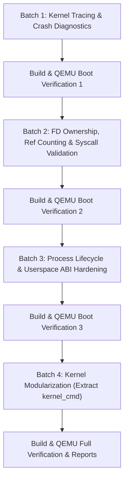

# FirstOS Kernel Architecture & Core Infrastructure Audit (Phase 1)

**Date**: 2026-10-15  
**Scope**: `/Users/mohamadjlo/Desktop/FirstOS`  
**Engineer**: FirstOS Principal Systems & Kernel Engineer  
**Objective**: Comprehensive audit of the core kernel, task/process lifecycle, memory management, syscall interface, IPC, and fault handling to harden FirstOS for modern applications (Browser, Developer Tools, Background Services).

---

## 1. Executive Summary

FirstOS features a 64-bit Long Mode monolithic kernel with Ring 0 / Ring 3 hardware privilege separation, preemptive multitasking, a 4-level PML4 paging subsystem, and an integrated VFS and network stack. Over successive iterations, support for POSIX-like capabilities, userspace ELF loading, shared memory (SHM), pipes, and futex synchronization was introduced.

However, rapid feature additions have created key structural bottlenecks:
1. **Lack of Unified Kernel Tracing**: Tracing currently relies on scattered `serial_write()` calls with no levels, subsystem filtering, or in-memory ring buffering for post-mortem crash analysis.
2. **Incomplete Fault & Crash Diagnostics**: Exception handling in `fault.c` only prints a subset of registers, relies on `current_task > 0` rather than `(frame->cs & 3) == 3` to detect privilege level, does not decode Page Fault error codes, and lacks a stack word dump.
3. **FD Ownership & Ref Counting Defect**: In `vfs_fd.c`, open files lack a `ref_count` and `owner_pid`. When a file descriptor is duplicated via `dup`, `dup2`, or inherited across `process_spawn`, closing any copy immediately frees the underlying buffer, corrupting active file handles in other processes.
4. **Syscall Validation & Pointer Checks**: Some syscall parameters (such as nested arrays like `argv`, unaligned pointers, and socket parameters) lack uniform pointer sanitization, risking kernel faults if user code passes corrupt pointers.
5. **Monolithic File Bloat**: `kernel.c` has expanded to 879 lines (~40KB), mixing hardware initialization, ACPI poweroff, and desktop boot logic with an extensive 350+ line serial REPL command dispatcher.

---

## 2. Detailed Subsystem Audit

### 2.1 `kernel.c` (Core Kernel & Boot Orchestration)
- **Current Responsibilities**:
  - GDT/IDT/TSS initialization and 64-bit entry orchestration.
  - Device driver bring-up (VirtIO-GPU, VirtIO-Net, VirtIO-Blk, Intel HDA, PS/2).
  - Main GUI compositor event loop (`kernel_main`).
  - Serial command parser (`serial_poll_commands`) handling over 25 commands (`APP_STUDIO_*`, `NAV:*`, `COMPAT_FIXTURE`, `SMOKE_TEST`, etc.).
- **Strengths**: Solid, sequential boot pipeline; reliable hardware discovery and fallback paths.
- **Bottlenecks & Flaws**:
  - `serial_poll_commands()` constitutes ~45% of the file, blending debugging/testing logic directly with kernel scheduling.
- **Recommendation**: Split `serial_poll_commands()` into a modular `kernel_cmd.c` / `kernel_cmd.h` subsystem, leaving `kernel.c` focused purely on boot, scheduler loops, and core execution.

### 2.2 `task.c` & `task.h` (Preemptive Scheduling & Task Switching)
- **Current Responsibilities**:
  - Task Control Block (`task_t`) managing 16 task slots (`MAX_TASKS`).
  - 16KB dedicated per-task Ring 0 kernel stacks (`TASK_KSTACK_SIZE`).
  - Timer-driven preemptive round-robin context switching (`timer_handler`, `task_yield`).
- **Strengths**:
  - Clean stack frame forged for 64-bit Long Mode task initialization.
  - Generous 16KB kernel stacks prevent stack overflows during nested interrupts.
- **Constraints & Risks**:
  - **CRITICAL ABI CONSTRAINT**: `sizeof(task_t)` is strictly 64 bytes (`shl rax, 6` in `isr.asm`). Any modification to `task_t` must strictly maintain this 64-byte alignment or assembly routines will corrupt task indexing.
  - Task states (`TASK_STATE_*`) lack atomic state transition logging.

### 2.3 `process.c` & `process.h` (Process Lifecycle & Security Model)
- **Current Responsibilities**:
  - Process table (`process_table`) tracking PID, PPID, state, role (`PROC_ROLE_*`), and security capabilities (`PROC_CAP_*`).
  - Ring 3 userspace process creation via `process_spawn` and replacement via `process_exec`.
  - Process exit, zombie tracking, child reparenting, and `process_waitpid`.
  - Per-process file descriptor table (`fds[FIRSTOS_MAX_FDS]`).
- **Strengths**:
  - Effective sandboxing of untrusted renderer processes (`PROC_ROLE_RENDERER` denied direct disk/network access).
  - Clean reparenting of orphan processes to init (PID 0) on exit.
- **Bottlenecks & Flaws**:
  - When open files are inherited across `process_spawn` (lines 523–544), `pipe_add_ref()` is called for pipes, but `vfs_fd` handles are copied without incrementing a reference count. Closing one handle frees the buffer for both parent and child.
  - User stack alignment on spawn: System V AMD64 ABI requires `(RSP + 8)` to be 16-byte aligned before calling `_start`. This must be validated for reliable C userspace runtimes.

### 2.4 `syscall.c` & `syscall.h` (System Call Gateway)
- **Current Responsibilities**:
  - Interrupt `0x80` entry handler dispatching `FIRSTOS_SYS_*` calls and routing Linux ABI calls to `linux_syscall_dispatcher()`.
  - User pointer validation (`validate_user_buffer`, `validate_user_string`).
- **Strengths**:
  - Strict address range enforcement (`FIRSTOS_USER_BASE` to `FIRSTOS_USER_TOTAL_END`).
  - Proper negative errno return convention (`-FIRSTOS_EFAULT`, `-FIRSTOS_EBADF`, etc.).
- **Bottlenecks & Flaws**:
  - Array pointers passed into `process_spawn` / `process_exec` (`const char *const *argv`) are not validated before reading array elements.
  - Syscall entry and exit logs write directly to serial, introducing serial I/O serialization delays on rapid syscall sequences.

### 2.5 `fault.c` & `fault.h` (Exception & Crash Handling)
- **Current Responsibilities**:
  - Interrupt vectors 0..31 handling (Divide error, Invalid Opcode, GPF, Page Fault, etc.).
  - Terminating faulted Ring 3 user tasks and recovering kernel execution.
- **Bottlenecks & Flaws**:
  - **Privilege Level Detection**: Uses `if (current_task > 0)` to decide whether to kill the task or panic the kernel. If a user process triggers a kernel fault (e.g., inside an unvalidated syscall handler), it incorrectly treats it as a user fault, possibly masking kernel bugs. The true test must check `(frame->cs & 3) == 3`.
  - **Truncated Register Dump**: Omits general-purpose registers (RAX, RBX, RCX, RDX, RSI, RDI, RBP, RSP), making post-mortem crash analysis difficult.
  - **Page Fault Decoding**: Does not decode the error code bitmask (Present, Write, User, Reserved, Instruction Fetch).
  - **No Stack Dump**: Does not print the top 4–8 words of the stack at `RSP`.

### 2.6 `vfs_fd.c` & `vfs_fd.h` (Virtual File Descriptors)
- **Current Responsibilities**:
  - Manages global table of 64 file descriptors (`s_vfs_fds`).
  - In-memory buffering of file data loaded from FAT disk.
- **Critical Flaws**:
  - No `ref_count` field in `vfs_fd_entry_t`.
  - No `owner_pid` tracking.
  - `vfs_close()` immediately deallocates `e->buffer` and wipes the entry, breaking any other FD that was duplicated via `dup`/`dup2` or inherited via `process_spawn`.

### 2.7 `pipe.c`, `shm.c`, `futex.c` (IPC & Synchronization)
- **Pipe Subsystem**: 16 kernel ring buffers of 4096 bytes each. Properly tracks `readers` and `writers` count.
- **Shared Memory (SHM)**: 8 regions of 4MB each, mapped into process Level 2 page directories with 2MB huge page User R/W entries (`0x87`). `shm_process_cleanup()` cleans mappings on exit.
- **Futex**: Supports `FUTEX_WAIT` and `FUTEX_WAKE` for up to 32 waiters. Handles task unblocking cleanly.

### 2.8 `paging.c` & `heap.c` (Memory & Paging Subsystems)
- **Paging**: 4-level PML4 table. Identity maps the first 4GB using 2MB huge pages. Process address spaces duplicate kernel PML4 entries to ensure kernel memory is uniformly accessible across all tasks.
- **Heap**: Bump/freelist kernel heap with aligned allocation (`kmalloc_aligned`) and statistics tracking (`heap_stats_t`). Peak allocation and OOM counters are maintained.

---

## 3. Prioritized Improvement Plan

To ensure maximum safety and zero regressions, changes will be executed in **discrete, incremental batches**, verifying build and QEMU boot after each:

### Detailed Batch Outline:
- **Batch 1 (Diagnostics & Tracing)**:
  - Implement `ktrace.h` / `ktrace.c`: Circular in-memory event buffer with subsystem tagging, levels, and crash dump export.
  - Upgrade `fault.c`: Full 16-register dump, accurate `(frame->cs & 3) == 3` Ring 3 detection, #PF bitmask decoding, stack inspection, and `ktrace` crash dump.
- **Batch 2 (FD Ownership & Syscall Validation)**:
  - Add `ref_count` and `owner_pid` to `vfs_fd_entry_t` in `vfs_fd.c`. Add `vfs_add_ref()`. Update `vfs_close()` to only free when `ref_count == 0`.
  - Update `process.c` (`process_spawn`, `proc_fd_dup`, `proc_fd_dup2`) to increment `vfs_add_ref()`.
  - Strengthen `syscall.c` pointer sanitization for nested pointer arrays (`argv`) and add structured rejection logging.
- **Batch 3 (Process Lifecycle & ABI Discipline)**:
  - Implement `process_set_state()` with transition validation and lifecycle tracing.
  - Harden userspace stack alignment (System V AMD64 ABI 16-byte alignment).
- **Batch 4 (Safe Modularization)**:
  - Propose and execute the split of `kernel.c` by moving `serial_poll_commands()` into `kernel_cmd.c` and `kernel_cmd.h`.
